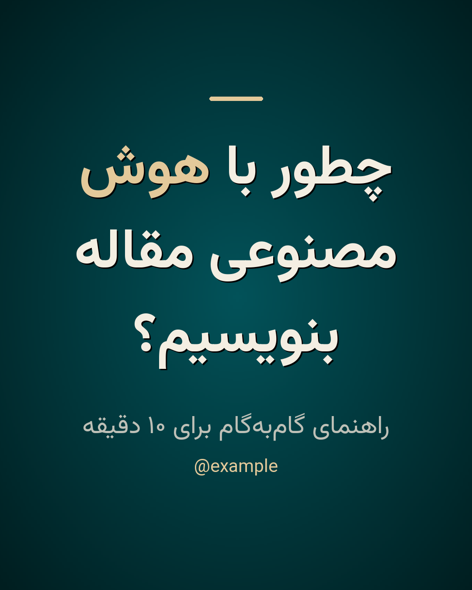
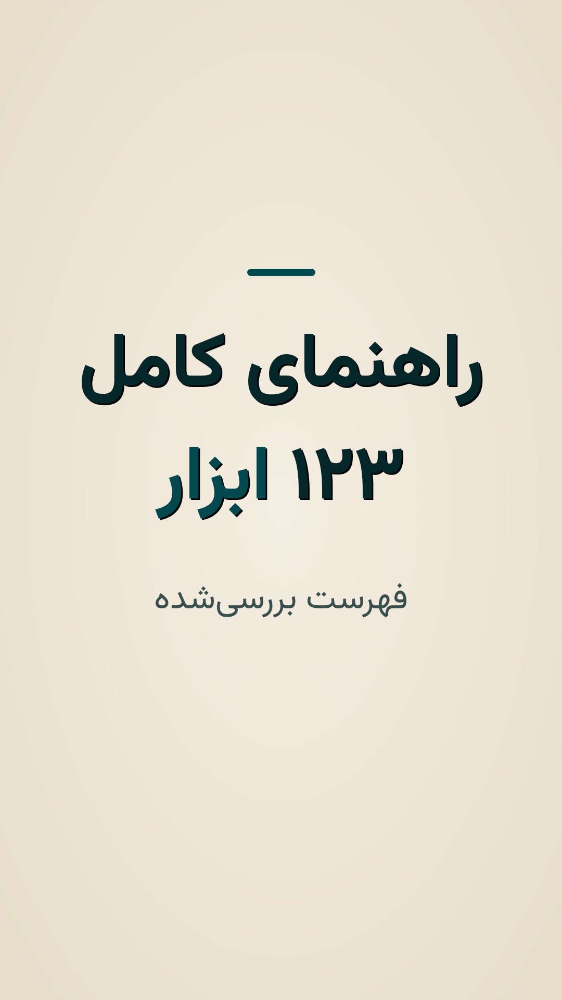
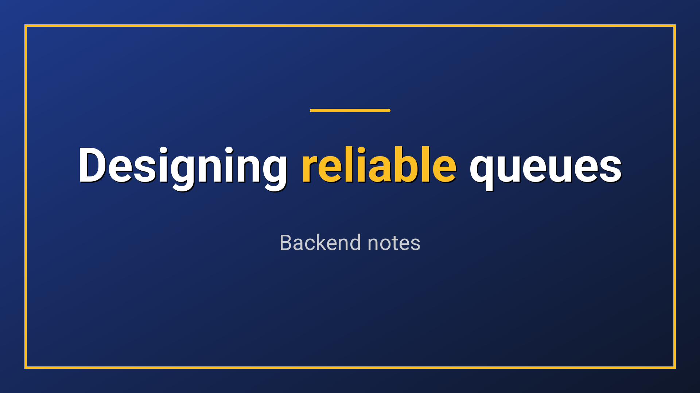

# persian-cover-engine

Render Persian (right-to-left) cover images from Python or the command line, with correct letter
shaping, WCAG-checked colour palettes, and a layout that stays inside the area Instagram shows in
a profile grid tile.

<p>
  
  
  
</p>

## Why this exists

Generating social-media covers with Pillow looks easy until the text is Persian. Letters must be
joined and reordered, titles of different lengths must still fit, and on Instagram the profile grid
crops a 9:16 cover to its centre 3:4 and draws icons over the corners, so text placed by eye gets cut
off. This library solves those three problems once, with tests.

## Features

- **Correct Persian text.** Uses Pillow's libraqm engine when available; otherwise falls back to
  `arabic-reshaper` + `python-bidi`. The backend is detected at runtime and can be forced with
  `PERSIAN_COVER_SHAPING=raqm|reshaper`.
- **Fit, don't overflow.** The title is wrapped and the font size is searched downwards until the
  block fits its box (line count, width of the widest word and height). The subtitle is capped at 46 %
  of the title size.
- **Grid-safe layout.** Text, accent bar and handle are placed inside the centre 3:4 crop of the
  canvas (configurable). Tests assert that every planned line stays inside that box for five titles
  on every canvas size, and that no pixel outside it changes when text is drawn (story size).
- **Accessible palettes.** Built-in palettes are validated against WCAG 2.x contrast
  (text and subtitle >= 4.5, accent >= 3); the test suite fails if a palette regresses.
- **Small API.** Pure `plan()` (geometry, no drawing) and `render()` (Pillow image) functions,
  frozen dataclasses, full type hints (`mypy --strict` clean).
- **Persian digits.** Latin digits inside Persian text are converted to Persian digits.
- **Any font.** Ships Vazirmatn (SIL OFL); pass `font_path` / `bold_font_path` to use your own.

## Install

```bash
pip install .                         # needs libraqm + fribidi on the system for the best quality
pip install ".[fallback-shaping]"     # pure-Python fallback for systems without libraqm
```

Debian/Ubuntu: `sudo apt-get install libraqm0 libfribidi0`. macOS: current Pillow wheels usually include raqm (check with `PIL.features.check('raqm')`).

## Use

```bash
persian-cover "چطور با هوش مصنوعی مقاله بنویسیم؟" \
  --subtitle "راهنمای گام‌به‌گام" --highlight "هوش" --handle "@example" \
  --size story --palette teal --out cover.png

persian-cover --contrast-report        # WCAG contrast of every palette
persian-cover --spec cover.json        # same options from a JSON file
```

```python
from persian_cover import CoverSpec, plan, render

spec = CoverSpec(
    title="چطور با هوش مصنوعی مقاله بنویسیم؟",
    subtitle="راهنمای گام‌به‌گام",
    highlight="هوش",  # drawn in the accent colour
    size="story",  # post | square | story | wide
    palette="teal",  # midnight | teal | ivory | graphite
)
render(spec).save("cover.png")

layout = plan(spec)  # inspect where everything goes without drawing
print(layout.safe, [line.box for line in layout.title])
```

### Docker

```bash
docker build -t persian-cover-engine .
docker run --rm -v "$PWD:/out" persian-cover-engine "سلام دنیا" --out /out/cover.png
```

## Design notes

| Decision | Reason |
| --- | --- |
| `plan()` is separate from `render()` | Layout can be unit-tested without comparing images. |
| Fit by search over font sizes | Predictable and easy to reason about; the search space is tiny (steps of 4 px). |
| Backgrounds built with Pillow gradients and a lookup table | No NumPy dependency; a test checks that two renders are byte-identical. |
| Palette contrast validated in code | A colour change that hurts legibility fails CI instead of shipping. |

## Limitations

- The 3:4 grid crop and the position of Instagram's overlay icons are conventions that the platform
  has changed before. `grid_aspect` is configurable, but check the result in the app.
- Only one title style is implemented (centred, optional single highlighted word). The first matching
  word is highlighted.
- Without libraqm the fallback path depends on the font containing Arabic presentation forms
  (Vazirmatn does).

## Development

```bash
make install   # editable install with dev tools
make check     # ruff, ruff format --check, mypy --strict
make test      # pytest
```

CI runs lint, the tests on Python 3.10-3.13 with both shaping backends, and a Docker build.

## Licence

Code: MIT (see `LICENSE`). Bundled font Vazirmatn: SIL Open Font License 1.1
(`src/persian_cover/fonts/OFL.txt`).
